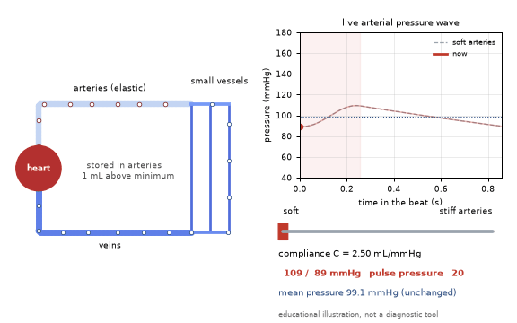
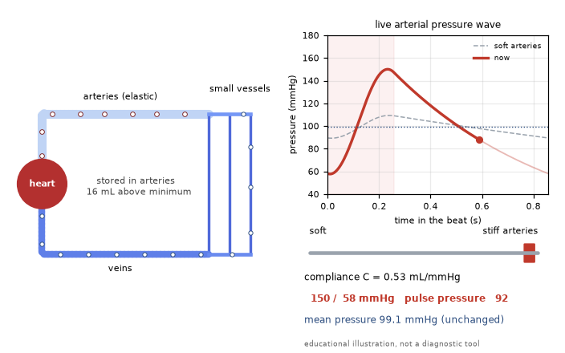
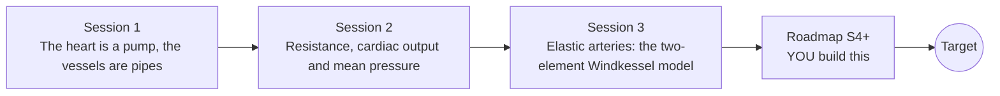

# openheartflow

[](https://github.com/KrunalPanchal1995/openheartflow/actions/workflows/ci.yml)   [](https://colab.research.google.com/github/KrunalPanchal1995/openheartflow/blob/main/sessions/session-01/lesson.ipynb) [](https://krunalpanchal1995.github.io/openheartflow/)

**Build a pump and pipes model of the circulation and watch blood pressure appear.**

openheartflow teaches how the heart and blood vessels create blood pressure, from flow = push / resistance to a pulsing arterial model solved with your own Runge-Kutta code, using only Python and a browser.

- **Start from zero.** Session 1 needs only school arithmetic: flow equals push divided by resistance.
- **See it move.** Every session ships a slider app that runs in the browser, with labelled graphs.
- **Know you got it right.** Each session ends with a checkpoint that prints PASS or FAIL against hand calculations and an exact solution.
- **Build the missing half.** The repo stops at Session 3 on purpose; the roadmap shows the path to the Target.

[Target](#the-target) · [Who is this for](#who-is-this-for) · [Quick start](#quick-start) · [Sessions](#sessions) · [Roadmap](#roadmap) · [Contribute](#contribute) · [Explainer PDF](docs/explainer.pdf)

> **This repo is incomplete on purpose.** Sessions 1 to 3 are here and fully working. The finished Target below is a preview of what the community can build next. We show you the path, not the code. Sessions 4 and up are yours.

## The Target

A loop of heart, arteries, small vessels and veins pulses with every heartbeat while a live pressure wave is drawn beside it. A slider makes the arteries stiffer and softer: the wave swings wider as the arteries stiffen, yet the average pressure does not move. Your goal over the coming sessions: build this animated circulation yourself, including a heart valve and arteries that stiffen with pressure. It is an educational illustration, not a diagnostic tool.



*Target: a pulsing circulation loop, a live pressure wave and a stiffness slider (educational illustration)*



*Target still: stiff arteries give a wider pressure swing at the same mean pressure*

Try it live:

- [Math Visual Studio: conservation laws for fluids (Atlas S59)](https://krunalpanchal1995.github.io/studio/#atlas?ch=S59&ex=1)
- [Math Visual Studio: internal flow in pipes (Atlas S61)](https://krunalpanchal1995.github.io/studio/#atlas?ch=S61&ex=1)

How the Target was made is shown only as a path in [promo/roadmap.md](promo/roadmap.md).

## Who is this for
**secondary school to diploma / undergraduate (levels 3-5).** Topic area: Biology, Human Body and Health Science.

Prerequisites:

- Basic arithmetic and the idea of a graph (school level); powers such as r to the 4 are explained in Session 2.
- Python 3.10 or newer; if `python --version` works, you are ready. PRIMER.md explains the rest.
- No prior biology, GitHub or differential equations experience is needed. This is general education, not medical advice.

New to Python? Read [PRIMER.md](PRIMER.md) first (10 minutes).

## Quick start

No installation knowledge needed. You need [Git](https://git-scm.com/downloads) and [Python 3.10+](https://www.python.org/downloads/) (Windows: tick "Add Python to PATH"). On Mac and Linux type `python3` wherever this page says `python`.

```bash
git clone https://github.com/KrunalPanchal1995/openheartflow.git
cd openheartflow
python start.py 1
```

`start.py` creates a private environment, installs what is needed and runs Session 1 with its checkpoint. Next: `python start.py 2`, `python start.py 3`, or `python start.py test` to check everything. Only a checkpoint: `python start.py check 1`.

Four lines show the idea of Session 3: the pressure in a stretchy artery decays exponentially when the heart rests (they work as they are): Save it as `try.py` and run it with `python start.py run try.py` (this uses the private environment, where NumPy is installed):

```python
import numpy as np
R, C, dt = 1.2, 1.25, 0.001              # mmHg s/mL, mL/mmHg, s
P = 80.0                                  # pressure in mmHg when the heart stops pushing
for k in range(1000): P += dt * (0.0 - P / R) / C   # Euler steps for 1 s of rest
print(round(P, 1), round(80 * np.exp(-1.0 / (R * C)), 1))   # numerical and exact: 41.1 41.1
```

Every session also opens in your browser with sliders (no install): [live apps](https://krunalpanchal1995.github.io/openheartflow/). Or use the Colab badge above for the notebook.

## Sessions

| # | Session | Model level | Time | Live app |
|---|---|---|---|---|
| 1 | [The heart is a pump, the vessels are pipes](sessions/session-01/README.md) | Level 1: conceptual interactive model | 60 min | [open](https://krunalpanchal1995.github.io/openheartflow/session-01/) |
| 2 | [Resistance, cardiac output and mean pressure](sessions/session-02/README.md) | Level 2: mathematical engineering model | 75 min | [open](https://krunalpanchal1995.github.io/openheartflow/session-02/) |
| 3 | [Elastic arteries: the two-element Windkessel model](sessions/session-03/README.md) | Level 3: simulation and validation | 90 min | [open](https://krunalpanchal1995.github.io/openheartflow/session-03/) |

Each session follows the same six steps: A real-world problem, B concept and theory, C visual explanation, D interactive simulation, E worked example and experiment, F assessment and design challenge. Each ends with `checkpoint.py`, which prints `PASS` or `FAIL` against reference numbers. Session 3 also contains the real-world mini-project: **Tune the arterial model to an illustrative 120/80 mmHg waveform**.

## Architecture



| Folder or file | What is inside |
|---|---|
| `sessions/` | three sessions: README (A-F), `lesson.py`, notebook, live app, exercises, activity sheet, checkpoint |
| `promo/` | the Target: media, live links, and the roadmap (path only) |
| `docs/` | `explainer.tex` and the built `explainer.pdf` |
| `tests/` | runs every lesson and checkpoint headless |
| `start.py` | one command to set up and run anything |
| `QUALITY.md`, `RUBRIC.md` | the quality checklist and the scoring rubric |
| `.github/` | CI, PDF build, Pages deploy, issue and PR templates |

## Roadmap

| Milestone | What you will build | Difficulty |
|---|---|---|
| Session 4: A three-element Windkessel | A model with a resistor in series with the compliance and resistance, solved with your own RK4. | intermediate |
| Session 5: Add a heart valve and let the stroke volume emerge | A ventricle pressure model coupled to the Windkessel through a valve. | advanced |
| Session 6: Arteries that stiffen with pressure | A pressure-dependent compliance C(P) in the same RK4 solver. | intermediate |
| Session 7: A simple feedback on the resistance | A controller that adjusts R each beat to hold the mean pressure at a set value. | advanced |
| Session 8: From a lump to an arterial network | A chain of Windkessel segments or a one-dimensional wave model. | advanced |

Full detail with a checkpoint per milestone: [promo/roadmap.md](promo/roadmap.md).

## Contribute
New to GitHub? Read [CONTRIBUTING.md](CONTRIBUTING.md); it starts from zero. Pick an issue labelled `good first issue`. Translations into Hindi, Telugu, Tamil and Malayalam are welcome.

<details>
<summary>Development</summary>

```bash
python start.py test        # runs every lesson and checkpoint
```
Lessons use `# %%` cell markers so they open as notebooks in VS Code. See [QUALITY.md](QUALITY.md) for the standard every session meets.
</details>

## License
MIT. See [LICENSE](LICENSE). Media in `promo/media` is (c) Krunal Panchal, CC BY 4.0.

## Acknowledgments
Part of the [PAN IIT OSS](https://hellofoss.tech-iitb.org/projects) open-source teaching collection, modelled on the structure of [openspline](https://github.com/openspline/openspline). Built on ideas from the Math Visual Studio at https://krunalpanchal1995.github.io/studio/.
