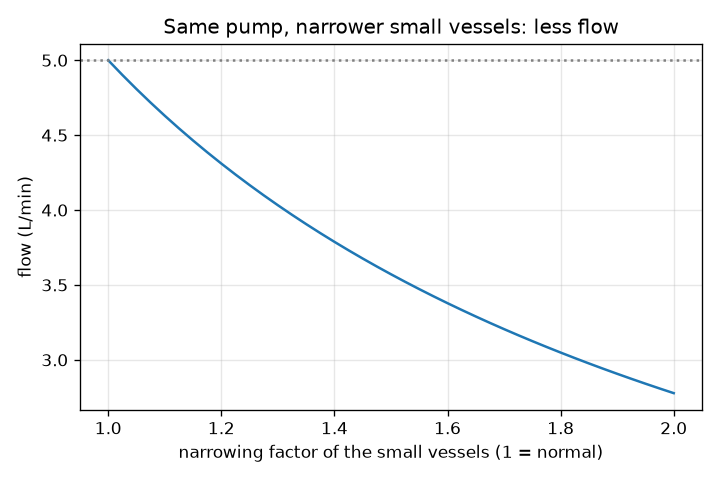
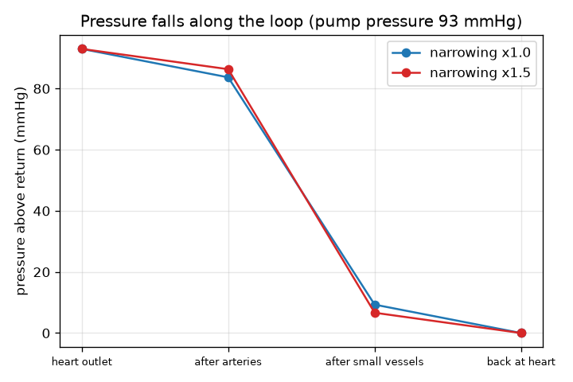

# Session 1: The heart is a pump, the vessels are pipes

*Level 1 (conceptual interactive model) · about 60 minutes · openheartflow*

> This is a simplified educational model. It is not a validated design tool and must not be used for real structures, electrical installations, vehicles, industrial processes or medical decisions.

**Prerequisites**

- Basic arithmetic: multiplication, division, percentages.
- You have read PRIMER.md and run `python start.py 1` once.

**Learning objectives.** After this session you can:

- Describe the circulation as a closed loop: heart, arteries, small vessels, veins, back to the heart.
- Use flow = pressure difference / resistance to find a flow, a resistance or the push needed.
- Explain why the pressure falls along the loop and why narrow small vessels cost the pump more effort.
- Read a graph of pressure along the loop.

## A. Real-world problem
Blood goes round and round in a closed loop of tubes; the same blood returns to the heart again and again. What pushes it, and why does the push have to be so much larger than it seems? Your heart is a pump, and the arteries, small vessels and veins are pipes that resist the flow. If the small vessels narrow, does the flow fall, or does the heart push harder? This is general education only: it is not medical advice and the model is not a diagnostic tool. Never use it to judge anyone's health.

## B. Concept and theory
A pump creates a pressure difference dP between the outlet and the return. The pipes resist the flow with a resistance R. The flow Q is dP divided by R: more push gives more flow, more resistance gives less flow. This is Ohm's law for pipes (voltage becomes pressure, current becomes flow). Pressure in medicine is quoted in mmHg (millimetres of mercury); flow of blood in litres per minute (L/min). The loop has three kinds of pipe one after another: the arteries, the small vessels (arterioles and capillaries, where blood feeds the tissues) and the veins. Pipes in a row add their resistances and the same flow passes through each, so the pressure lost in one pipe is Q times its resistance. The pressure therefore steps down along the loop and reaches the return pressure, which we take as 0. Typical textbook numbers: a push of 93 mmHg and a total resistance of 18.6 mmHg per L/min give 5 L/min. Our illustrative split of the resistance is 10 percent in the arteries, 80 percent in the small vessels and 10 percent in the veins.

| Symbol | Meaning | Unit |
|---|---|---|
| dP | pressure difference produced by the pump (above the return pressure) | mmHg |
| R | resistance of the pipes | mmHg per (L/min) |
| Q | flow of blood round the loop | L/min |
| narrow | factor that multiplies the resistance of the small vessels (1 = normal) | no unit |

**Assumptions**

- Steady, average flow: we ignore the individual heartbeats (Session 3 adds them).
- The return pressure is taken as 0, so dP is the pressure above it.
- The 10/80/10 split of the resistance is illustrative, not a measurement.
- Typical textbook values, not a norm for any person.
- General education: not medical advice and not a diagnostic tool.

$$ Q=\frac{\Delta P}{R} $$

$$ R_{\mathrm{total}}=R_{\mathrm{arteries}}+R_{\mathrm{small}}+R_{\mathrm{veins}} $$

$$ \Delta P_{\mathrm{segment}}=Q\,R_{\mathrm{segment}} $$

## C. Visual explanation
The first figure plots the pressure along the loop for a pump pressure of 93 mmHg. For normal small vessels it steps from 93 down to 83.7 after the arteries, then to 9.3 after the small vessels, then to 0 back at the heart: the small vessels take almost all of the drop. The second figure plots the flow of the same pump against the narrowing of the small vessels: it starts at 5.0 L/min for normal vessels and falls to 2.78 L/min when the resistance of the small vessels is doubled.

*The same pump delivers less flow as the small vessels narrow.*

*Pressure along the loop: the small vessels take most of the drop; narrowing them makes it larger.*

## D. Interactive simulation
Run the lesson (`python start.py 1`), then open the live app: [Session 1: pump and pipes](https://krunalpanchal1995.github.io/openheartflow/session-01/) (or `app.html` in this folder). Drag the pump pressure and the narrowing sliders and watch the colours of the loop and the flow. Switch to the pressure graph and see the grey line (normal vessels) and the blue line (your setting).

**Challenge.** Narrow the small vessels to 1.5 times and raise the pump pressure until the flow is back to 5 L/min (within 0.2).

## E. Worked example and experiment
**Problem.** A pump gives 93 mmHg. The total resistance of the loop is 18.6 mmHg per L/min, split 10/80/10. Find the flow. Then the small vessels narrow so that their resistance is 1.5 times larger: find the new flow, and the push needed to keep 5 L/min.

1. Total resistance = 0.10 x 18.6 + 0.80 x 18.6 + 0.10 x 18.6 = 18.6 mmHg per L/min.
2. Flow = 93 / 18.6 = 5.0 L/min. The small vessels lose 5.0 x 14.88 = 74.4 mmHg of the 93.
3. Narrowed: the small vessels now have 14.88 x 1.5 = 22.32; total = 1.86 + 22.32 + 1.86 = 26.04 mmHg per L/min.
4. Same pump: flow = 93 / 26.04 = 3.57 L/min.
5. To keep 5 L/min the pump must give 5 x 26.04 = 130.2 mmHg.

**Answer.** Normal flow 5.0 L/min. After the narrowing the same pump gives 3.57 L/min; to restore 5 L/min the push must rise to 130.2 mmHg.

**Experiment.** Connect a garden hose to a tap, open it fully and time how long it takes to fill a 10 litre bucket; then pinch the hose partly with your fingers and time it again. The tap pressure is the same, but the flow is smaller, as the model says. Differences from the model: the hose wall is stretchy, water is thinner than blood, the tap pressure sags when the flow is large, and a real body adjusts its vessels and its heart. The model is a ruler, the real circulation is a living, regulated system.

## F. Assessment and design challenge
**Question type A: Conceptual.** Why is the pressure highest at the heart outlet and lowest just before the heart, and why do the small vessels cause the largest drop?

Hint

The pressure lost in a pipe is Q times its resistance, and the same Q flows through every pipe in a row.

Step-by-step solution

Blood flows from high to low pressure, and each pipe uses up pressure equal to Q times its resistance. The same flow Q passes every segment, so the segment with the largest resistance loses the most pressure. In our illustrative split the small vessels have 80 percent of the resistance, so they use up 80 percent of the push. The pressure reaches its lowest value (taken as 0) back at the heart.

**Question type B: Numerical.** A pump gives only 60 mmHg through the typical resistance of 18.6 mmHg per L/min. What is the flow? Is the answer sensible?

Hint

Q = dP / R.

Step-by-step solution

Q = 60 / 18.6 = 3.23 L/min. Sensible: a smaller push through the same pipes must give a smaller flow than the 5 L/min of the 93 mmHg case, and 60/93 of 5 is 3.2. Units: mmHg divided by mmHg per L/min is L/min.

**Question type C: Graph and simulation interpretation.** In the pressure graph with narrowing 1.5 and a 93 mmHg pump, how much pressure do the small vessels use up, and how does that compare with normal vessels?

Hint

Read the drop between the points at position 1 and position 2, or use Q times R of the small vessels.

Step-by-step solution

With narrowing 1.5 the flow is 3.57 L/min and the small vessels lose 3.57 x 22.32 = 79.7 mmHg (85.7 percent of the push), against 74.4 mmHg (80 percent) for normal vessels. The narrowed vessels take a bigger share of a smaller flow's pressure; the arteries and veins lose less, because the flow through them is smaller.

**Question type D: Design and optimisation challenge.** Design: the pump can give at most 120 mmHg and the flow must stay at or above 4.5 L/min. How much can the small vessels narrow (to 2 decimal places)? State the trade-off.

Hint

The total resistance may be at most 120 / 4.5; solve 18.6 x (0.2 + 0.8 x narrow) for narrow.

Step-by-step solution

R_total <= 120 / 4.5 = 26.67, so 0.2 + 0.8 x narrow <= 26.67 / 18.6 = 1.434, so narrow <= 1.54. At 1.54 the flow is 4.51 L/min; at 1.55 it is 4.48 L/min, just too low. Trade-off: a pump that must push this hard works much harder, and a real body cannot raise its pressure without limit. Assumptions: steady flow, the illustrative 10/80/10 split. General education only, not a clinical limit.

Score yourself with [RUBRIC.md](../../RUBRIC.md). Print the [activity sheet](activity_sheet.md) to work on paper.

## Common misconceptions
| Common misconception | What is actually true |
|---|---|
| Blood pressure is the same everywhere in the loop. | It falls along the loop, steeply in the small vessels, and reaches the lowest value back at the heart. |
| Narrow vessels give more flow because the blood is squeezed through. | With the same pump pressure, more resistance means less flow around the loop. |
| The blood is used up or lost on the way. | The loop is closed: the flow leaving the heart equals the flow returning to it. Only the pressure is used up. |
| Most of the resistance is in the big arteries. | In this model (and in typical textbooks) most of it is in the small vessels, which is why they matter so much for pressure. |

## Glossary
- **pressure**: force per area; in blood circulation quoted in mmHg
- **mmHg**: millimetre of mercury, a unit of pressure used for blood pressure
- **resistance**: how strongly pipes oppose flow; flow = push / resistance
- **flow**: volume of blood passing per minute, in L/min
- **capillary**: the tiniest vessel, where blood exchanges with the tissues
- **arteriole**: a small artery that feeds the capillaries

## Finish
1. Do the three coding tasks in [exercises.md](exercises.md).
2. Run `python start.py 1` again after your changes. It ends with the checkpoint; when it prints `PASS`, you are done. (Checkpoint only: `python start.py check 1`.)

Next: [Session 2](../session-02/README.md)
