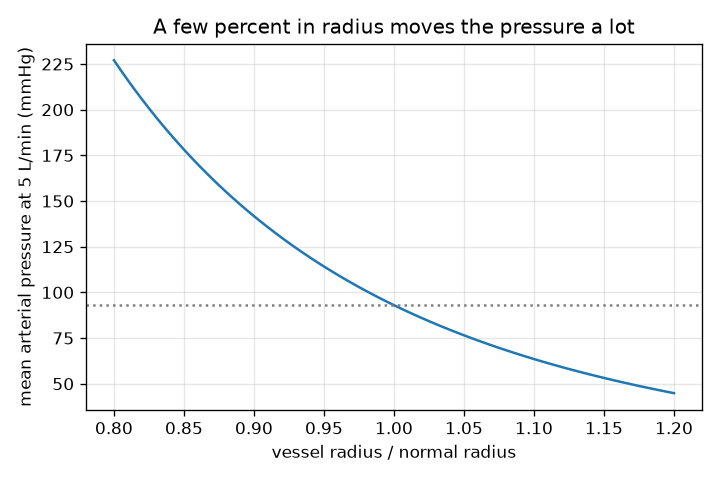
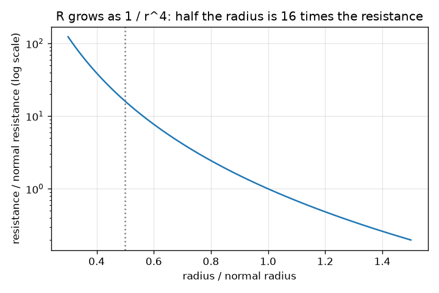

# Session 2: Resistance, cardiac output and mean pressure

*Level 2 (mathematical engineering model) · about 75 minutes · openheartflow*

> This is a simplified educational model. It is not a validated design tool and must not be used for real structures, electrical installations, vehicles, industrial processes or medical decisions.

**Prerequisites**

- Session 1: flow = push / resistance.
- Powers such as r to the 4 (explained in Section B).

**Learning objectives.** After this session you can:

- Use Poiseuille's law to compute the resistance of a vessel and show that half the radius means 16 times the resistance.
- Compute cardiac output from heart rate and stroke volume and convert units (mmHg, mL, L/min).
- Use MAP = CO x TPR to predict how the mean pressure responds to heart rate, stroke volume and vessel radius.
- Solve a design problem with constraints and state its assumptions.

## A. Real-world problem
Your body can change the width of its small vessels in seconds, and a change of only a few percent in radius changes how hard the heart has to push. Why is the effect so large? If the resistance of the loop rises by 20 percent while the heart keeps pumping the same output, what happens to the pressure? And what would halving a vessel's radius do? All values are typical textbook figures, not a norm for any person; this is general education, not medical advice.

## B. Concept and theory
For slow, smooth (laminar) flow of a thick liquid of viscosity mu in a straight round tube of length L and radius r, Poiseuille's law gives the resistance R = 8 mu L / (pi r^4). The radius appears to the fourth power: the open area grows as r squared, and the average speed grows as r squared again, so the flow grows as r to the 4. Half the radius therefore gives 2^4 = 16 times the resistance. The heart ejects a stroke volume SV (mL) per beat; with heart rate HR (beats per minute) the cardiac output is CO = HR x SV, which is 70 x 70 mL = 4.9 L/min, about 5 L/min, for typical textbook values. The flow through the whole body obeys Q = dP / R, so with the return pressure taken as 0 the mean arterial pressure is MAP = CO x TPR, where TPR (total peripheral resistance) is the total resistance. Typical textbook values of 93 mmHg and 5 L/min give TPR = 18.6 mmHg per (L/min). From a reading 'systolic over diastolic' a common rule of thumb is MAP = diastolic + (systolic - diastolic)/3, which is 93.3 mmHg for 120/80.

| Symbol | Meaning | Unit |
|---|---|---|
| mu | viscosity of blood (typical 3.5e-3, treated as constant) | Pa s |
| L | length of the vessel | m |
| r | radius of the vessel | m |
| R | resistance of the vessel | Pa s / m^3 (or mmHg per mL/s) |
| HR | heart rate | beats per minute |
| SV | stroke volume (blood pumped per beat) | mL |
| CO | cardiac output | L/min |
| TPR | total peripheral resistance | mmHg per (L/min) |
| MAP | mean arterial pressure | mmHg |

**Assumptions**

- Laminar flow of a Newtonian fluid (constant viscosity) in straight, rigid, round tubes: real blood vessels are none of these exactly.
- The return pressure is about 0, so MAP is the pressure above it.
- The resistance is dominated by the small vessels, and they all change radius together by the same factor.
- Typical textbook values, labelled typical; not a norm for any person.
- General education: not medical advice and not a diagnostic tool.

$$ R=\frac{8\,\mu\,L}{\pi\,r^{4}} $$

$$ \frac{R(r/2)}{R(r)}=2^{4}=16,\qquad \frac{R(kr)}{R(r)}=k^{-4} $$

$$ \mathrm{CO}=\mathrm{HR}\times\mathrm{SV} $$

$$ \mathrm{MAP}=\mathrm{CO}\times\mathrm{TPR} $$

$$ \mathrm{MAP}\approx P_{\mathrm{dia}}+\tfrac{1}{3}\,(P_{\mathrm{sys}}-P_{\mathrm{dia}}) $$

## C. Visual explanation
The first figure plots the mean arterial pressure against the vessel radius at a constant 5 L/min. At normal radius it is the typical 93 mmHg; with the radius 10 percent smaller (0.9 of normal) it is 141.7 mmHg, and with the radius 10 percent larger it is 63.5 mmHg: the curve is steep and not symmetric. The second figure shows the resistance factor 1/r^4 on a logarithmic scale; at half the radius it passes through 16.

*MAP against vessel radius at 5 L/min: a few percent in radius moves the pressure a lot.*

*Resistance factor 1/r^4 on a log scale: half the radius is 16 times the resistance.*

## D. Interactive simulation
Run the lesson (`python start.py 2`), then open the live app: [Session 2: output, resistance and pressure](https://krunalpanchal1995.github.io/openheartflow/session-02/) (or `app.html` in this folder). Move the heart rate, stroke volume and radius sliders. In the picture the bar is the mean arterial pressure and the dashed circle is the normal vessel. Switch to the graph to see where you are on the MAP curve.

**Challenge.** Make the vessels 5 percent narrower (radius 0.95 or less) and still keep the mean arterial pressure at or below 100 mmHg by changing heart rate and stroke volume.

## E. Worked example and experiment
**Problem.** A vessel 0.10 m long has radius 1.0 mm; blood has mu = 3.5e-3 Pa s. Find its resistance in mmHg per (mL/s), the flow for a push of 10 mmHg, and the same for radius 0.5 mm. Then: at a constant 5 L/min with TPR = 18.6, what happens to MAP if the resistance rises by 20 percent, and what radius change causes such a rise?

1. R = 8 mu L / (pi r^4) = 8 x 3.5e-3 x 0.10 / (pi x (1.0e-3)^4) = 2.8e-3 / 3.142e-12 = 8.913e8 Pa s per m^3.
2. Convert: x 1e-6 (m^3 to mL) / 133.322 (Pa per mmHg) = 6.685 mmHg per (mL/s).
3. Flow for 10 mmHg: 10 / 6.685 = 1.496 mL/s.
4. Radius 0.5 mm: R is 16 times larger = 106.96 mmHg per (mL/s); the flow for 10 mmHg is 10 / 106.96 = 0.0935 mL/s, 16 times smaller.
5. TPR rises by 20 percent: 18.6 x 1.2 = 22.32. At constant 5 L/min, MAP = 5 x 22.32 = 111.6 mmHg (also 20 percent higher than 93).
6. The radius ratio k that gives resistance x1.2 satisfies k^-4 = 1.2, so k = 1.2^(-1/4) = 0.9554: the radius is only 4.5 percent smaller.

**Answer.** R = 6.685 mmHg per (mL/s) for r = 1.0 mm and 106.96 for r = 0.5 mm (16 times). A 20 percent rise in resistance at constant output raises MAP from 93 to 111.6 mmHg, and it needs a radius only 4.5 percent smaller.

**Experiment.** Take a drinking straw and a thinner coffee stirrer tube of similar length. Blow or suck water through them from the same height of water tank, or time how long 100 mL of water takes to drain through each from a bottle. The thinner tube is far slower: the time scales roughly as 1/r^4. Differences from the model: the tubes are not perfectly round or smooth, the flow at the tube entrance is not laminar, and real blood has red cells that make its viscosity change with the vessel size. The model gets the strong dependence on radius right, not the exact numbers.

## F. Assessment and design challenge
**Question type A: Conceptual.** Why does the resistance depend on the radius to the fourth power and not just on the cross-section area (radius squared)?

Hint

Flow = area x average speed. What happens to the average speed in a wider tube, where more of the liquid is far from the slow layer at the wall?

Step-by-step solution

The flow is the open area times the average speed. The area grows as r squared. In a wider tube more of the liquid is far from the wall, where friction slows it, so the average speed also grows as r squared for the same push. Together the flow grows as r^4, so the resistance shrinks as 1/r^4. The outcome: small changes in radius have a big effect.

**Question type B: Numerical.** A heart beats 80 times per minute with a stroke volume of 60 mL. Find the cardiac output, and the MAP for a TPR of 18.6 mmHg per (L/min). Check the units.

Hint

CO = HR x SV in mL per min, then divide by 1000.

Step-by-step solution

CO = 80 x 60 = 4800 mL/min = 4.8 L/min. MAP = 4.8 x 18.6 = 89.3 mmHg. Units: (L/min) x (mmHg per L/min) = mmHg. It is close to the typical 93 mmHg, as expected for a slightly lower output.

**Question type C: Graph and simulation interpretation.** In the graph of MAP against radius at 5 L/min, read the MAP at radius 0.9 and 1.1 of normal. Why are the two changes from 93 not equal?

Hint

Evaluate 93 x r^-4 for both radii.

Step-by-step solution

At 0.9: 93 x 1.524 = 141.7 mmHg (a rise of 48.7). At 1.1: 93 x 0.683 = 63.5 mmHg (a fall of 29.5). The curve 1/r^4 is convex: narrowing raises the resistance faster than widening lowers it, so the two changes differ. Units: mmHg.

**Question type D: Design and optimisation challenge.** Design: the vessels are 5 percent narrower (radius 0.95 of normal) and the mean arterial pressure must stay at or below 100 mmHg. Find the largest cardiac output and choose a heart rate and stroke volume. State the trade-offs.

Hint

TPR rises by 0.95^-4; then CO = MAP / TPR.

Step-by-step solution

The resistance factor is 0.95^-4 = 1.228, so TPR = 18.6 x 1.228 = 22.8. CO <= 100 / 22.8 = 4.38 L/min. For instance 60 beats per minute x 70 mL = 4.2 L/min gives MAP = 95.9 mmHg. Trade-off: a lower output delivers less blood to the tissues, so a real body would not simply choose this; the model has no regulation. Assumptions: constant viscosity, all small vessels narrowed together, typical textbook values. General education only.

Score yourself with [RUBRIC.md](../../RUBRIC.md). Print the [activity sheet](activity_sheet.md) to work on paper.

## Common misconceptions
| Common misconception | What is actually true |
|---|---|
| Doubling the radius halves the resistance. | Resistance goes as 1/r^4: doubling the radius cuts the resistance to 1/16. |
| Pressure is set by the heart alone. | Pressure comes from flow times resistance, so both the output of the heart and the state of the vessels matter. |
| Poiseuille's law is exact for the arteries. | It assumes laminar flow of a constant-viscosity liquid in a straight rigid round tube; it is a good ruler for the dependence on radius, not an exact law for real vessels. |
| MAP is the average of the systolic and diastolic numbers. | The pressure stays near the diastolic value for longer than it stays near the systolic value, so MAP is nearer the diastolic: the rule of thumb adds one third of the difference. |

## Glossary
- **laminar flow**: smooth flow in layers, without eddies
- **viscosity**: how thick a liquid is, its internal friction (Pa s)
- **stroke volume**: the blood pumped by one beat (mL)
- **cardiac output**: blood pumped per minute = heart rate x stroke volume
- **TPR**: total peripheral resistance of the whole circulation
- **MAP**: mean arterial pressure, the average pressure in the arteries

## Finish
1. Do the three coding tasks in [exercises.md](exercises.md).
2. Run `python start.py 2` again after your changes. It ends with the checkpoint; when it prints `PASS`, you are done. (Checkpoint only: `python start.py check 2`.)

Next: [Session 3](../session-03/README.md)
