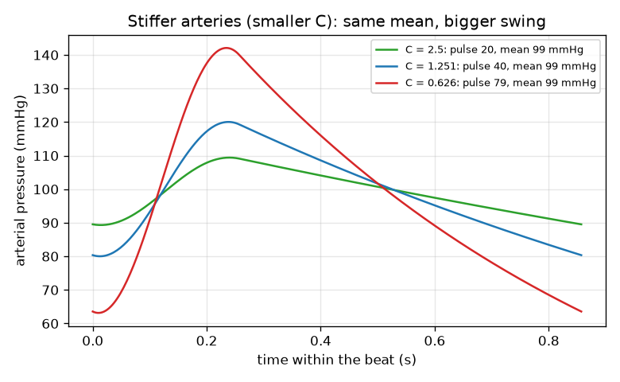
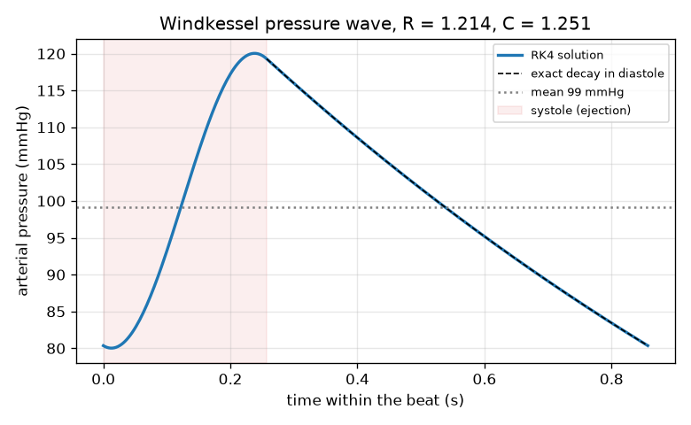

# Session 3: Elastic arteries: the two-element Windkessel model

*Level 3 (simulation and validation) · about 90 minutes · openheartflow*

> This is a simplified educational model. It is not a validated design tool and must not be used for real structures, electrical installations, vehicles, industrial processes or medical decisions.

**Prerequisites**

- Session 2: MAP = CO x TPR and units of resistance.
- Session 1: flow = push / resistance.
- The idea of a rate of change dP/dt (explained in Section B).

**Learning objectives.** After this session you can:

- Write the Windkessel equation C dP/dt = Q_in(t) - P/R and explain each term.
- Solve it with your own RK4 code and read systolic, diastolic, pulse and mean pressure from the wave.
- Validate the solver against the exact diastolic decay and the mean-flow balance, and measure its order of accuracy.
- Show the effect of stiffer arteries, heart rate and the parameters, and recognise the failure case.

## A. Real-world problem
The heart pushes blood out in short bursts, yet the pressure in the arteries never falls to zero between beats. Why? The big arteries are elastic: they swell during the burst, store blood, and squeeze it onwards while the heart rests, like the air chamber of an old fire pump (German: Windkessel). What sets the top and bottom pressure, and what happens when the arteries stiffen? This is general education; the model is a simplified illustration, not medical advice and not a diagnostic tool.

## B. Concept and theory
The arteries are modelled by two elements: an elastic compliance C (mL stored per mmHg of pressure rise) and a peripheral resistance R (mmHg s per mL) through which the stored blood drains. The ventricle forces in a flow Q_in(t): a half sine during the first 0.3 of each beat (systole, the ejection) and zero afterwards (diastole). Its peak is chosen so that one beat delivers exactly the stroke volume SV. Blood stored in C grows with the inflow and drains through R, which gives C dP/dt = Q_in(t) - P/R. In diastole Q_in is zero and the exact solution is an exponential decay P = P0 exp(-t/(R C)) with time constant R C. Averaged over a periodic beat the stored blood does not change, so the mean pressure equals R times the mean inflow. We solve the equation with Runge-Kutta 4 (RK4): four slope estimates per step, error shrinking as the step to the 4th power. The pressure waveform has a systolic value (highest), a diastolic value (lowest) and a pulse pressure (their difference). Stiffer arteries mean a smaller C.

| Symbol | Meaning | Unit |
|---|---|---|
| P | arterial pressure (the state of the model) | mmHg |
| C | arterial compliance | mL / mmHg |
| R | peripheral resistance | mmHg s / mL |
| Q_in | flow from the ventricle | mL/s |
| SV | stroke volume | mL |
| T_s | duration of systole, 0.3 of the beat | s |
| HR | heart rate | beats per minute |
| tau = R C | time constant of the decay in diastole | s |

**Assumptions**

- The ventricle delivers the same half-sine flow whatever the arterial pressure (a real heart ejects only while its pressure is above the arterial pressure, and the aortic valve then closes).
- One lump stands for the whole arterial tree: no travelling waves and no pressure amplification along the arteries.
- C and R are constants (real arteries stiffen as the pressure rises).
- Typical textbook values and an illustrative 120/80 target; not a norm for any person.
- General education: not medical advice and not a diagnostic tool.

$$ C\,\frac{dP}{dt}=Q_{\mathrm{in}}(t)-\frac{P}{R} $$

$$ Q_{\mathrm{in}}(t)=\begin{cases}\dfrac{\pi\,SV}{2\,T_s}\sin\!\left(\dfrac{\pi t}{T_s}\right)&0\le t<T_s\\[2mm] 0&T_s\le t<T\end{cases} $$

$$ P(t)=P_0\,e^{-t/(RC)}\quad\text{(diastole)} $$

$$ \overline{P}=R\,\overline{Q}_{\mathrm{in}}=R\,\frac{SV\cdot HR}{60} $$

$$ y_{n+1}=y_n+\tfrac{\Delta t}{6}\,(k_1+2k_2+2k_3+k_4) $$

## C. Visual explanation
The first figure shows one beat of the wave for R = 1.214 and C = 1.251: the pressure rises during the ejection (shaded), peaks at 120 mmHg, then decays along the dashed exact exponential to 80 mmHg. The second figure compares three compliances at the same R: for soft arteries (C = 2.5) the pulse pressure is only 20.1 mmHg, for the tuned case 40.0 mmHg and for stiff arteries (C = 0.626) 78.9 mmHg, while the mean pressure of 99.1 mmHg is the same in all three.

*Stiffer arteries (smaller C) give a larger pulse pressure at the same mean pressure.*

*One beat of the Windkessel pressure wave: RK4 and the exact diastolic exponential agree.*

## D. Interactive simulation
Run the lesson (`python start.py 3`), then open the live app: [Session 3: the Windkessel pressure wave](https://krunalpanchal1995.github.io/openheartflow/session-03/) (or `app.html` in this folder). Move the compliance slider and watch the wave: the mean stays but the swing grows as C falls. Then change R and the heart rate and compare with the mean-flow balance in the readout. Try C = 0.05 to see the failure case.

**Challenge.** Keep the mean pressure within 5 mmHg of 100 mmHg while the heart rate is 90 or more, by choosing R (the readout shows R x mean flow).

## E. Worked example and experiment
**Problem.** For R = 1.214 mmHg s/mL, C = 1.251 mL/mmHg, heart rate 70 and stroke volume 70 mL, find the time constant, the factor by which the pressure falls during diastole, the end-of-beat pressure when the pressure at the end of ejection is 119.3 mmHg, and the mean pressure from the mean-flow balance.

1. Beat length T = 60/70 = 0.857 s; systole T_s = 0.3 T = 0.257 s; diastole = 0.600 s.
2. Time constant tau = R C = 1.214 x 1.251 = 1.519 s.
3. Fall factor in diastole = exp(-0.600 / 1.519) = 0.674.
4. The simulation gives P = 119.3 mmHg at the end of ejection, so the pressure at the end of the beat is 119.3 x 0.674 = 80.4 mmHg.
5. The pressure dips to the minimum of 80.0 mmHg a hair after the next ejection starts (the inflow is still small), so the diastolic value is 80.0, the highest value is 120.0, and the pulse pressure is 40.0 mmHg.
6. Mean inflow = 70 x 70 / 60 = 81.67 mL/s, so the mean pressure = R x mean Q = 1.214 x 81.67 = 99.1 mmHg.

**Answer.** tau = 1.519 s, fall factor 0.674, end-of-beat pressure 80.4 mmHg (minimum 80.0), pulse pressure 40.0 mmHg and mean pressure 99.1 mmHg (equal to the simulated mean).

**Experiment.** Squeeze a soft bottle or a rubber bulb full of water in short pulses, with the outlet a thin tube. First let the water leave through a rigid tube and watch it spurt; then add a balloon (partly filled) in the line before the outlet and squeeze the same way: the outlet flow becomes smoother, because the balloon stores water in the burst and releases it between squeezes. A balloon that is stiffer (less inflated, or thicker rubber) smooths less. Differences from the model: the balloon is not linear (its pressure rises with volume in a curved way), the tube also stretches, and there is no valve to force one-way flow unless you add one. The model is a lump; the real arteries are a network with travelling waves.

## Real-world application and mini-project: Tune the arterial model to an illustrative 120/80 mmHg waveform
Use `last_beat` and `bp_stats` from Session 3 with a heart rate of 70 beats per minute and a stroke volume of 70 mL. Find the peripheral resistance R and the compliance C for which the model's systolic pressure is 120 mmHg and its diastolic pressure is 80 mmHg, each within 1 mmHg. Hint: the mean-flow balance fixes the mean pressure from R, and the pulse pressure is mostly set by C, so adjust them in turn or use a two-variable Newton iteration with finite differences. The target 120/80 is a typical textbook figure used here as an illustration; it is not a norm for any person and the model must never be used to interpret anyone's blood pressure.

**Deliverable:** A script that searches for R and C, prints them with the four numbers (systolic, diastolic, pulse pressure, mean), prints the largest gap between the numerical diastolic decay and the exact exponential, and saves a plot of one beat with the 120 and 80 lines.

**Success looks like:** Systolic is within 1 mmHg of 120 and diastolic within 1 mmHg of 80; the values you find are close to R = 1.21 mmHg s/mL and C = 1.25 mL/mmHg; the mean pressure equals R times the mean inflow to 0.05 mmHg; and you can explain why the mean pressure of the model (99.1 mmHg) is higher than the rule-of-thumb value 93.3 for 120/80.

## F. Assessment and design challenge
**Question type A: Conceptual.** Why does the arterial pressure not drop to zero in diastole when the heart is not pushing? Why does a stiffer artery change the pulse pressure but not the mean pressure?

Hint

Think of C as a store of blood and R as the tap that lets it out slowly. What does the mean-flow balance say the mean depends on?

Step-by-step solution

In diastole the stored blood drains through R, so the pressure decays exponentially with time constant R C, which is longer than the diastole, so it never reaches zero. A stiff artery stores less blood per mmHg (small C), so the same stroke volume makes a larger pressure swing: the pulse pressure grows. The mean pressure obeys mean P = R x mean Q, which contains neither C nor the shape of the wave, so it does not change.

**Question type B: Numerical.** With R = 1.214, a heart rate of 60 beats per minute and a stroke volume of 70 mL, find the mean pressure from the mean-flow balance. Compare with the 70 beats case (99.1 mmHg).

Hint

Mean inflow = SV x HR / 60 in mL/s, then multiply by R.

Step-by-step solution

Mean inflow = 70 x 60 / 60 = 70 mL/s, so mean P = 1.214 x 70 = 85.0 mmHg. It is lower than 99.1 by the factor 60/70, because the cardiac output is lower. Units: (mmHg s/mL) x (mL/s) = mmHg.

**Question type C: Graph and simulation interpretation.** In the stiffness figure the three waves have pulse pressures 20.1, 40.0 and 78.9 mmHg for C = 2.5, 1.251 and 0.626. What pattern do you see, and what is the mean pressure in each case?

Hint

Compare C times pulse pressure for the three curves and look at the dotted mean lines.

Step-by-step solution

Halving C roughly doubles the pulse pressure (40.0 to 78.9, a factor 1.97): the pulse pressure is roughly inversely proportional to C, because the stroke volume must be stored in the compliance. The mean pressure is 99.1 mmHg in all three, as the mean-flow balance says. The wave of stiff arteries also reaches higher at the top (142.1) and lower at the bottom (63.2) around the same mean.

**Question type D: Design and optimisation challenge.** Design: choose R and C so that the model has a mean pressure of 90 mmHg and a pulse pressure close to 30 mmHg at 70 beats per minute and 70 mL. Report the systolic and diastolic values. This is an illustrative exercise, not a target for any person.

Hint

R follows from the mean-flow balance; then try C values from 1.5 to 1.9 with last_beat and bp_stats.

Step-by-step solution

R = 90 / 81.67 = 1.102 mmHg s/mL. Trying C values: C = 1.7 gives systolic 105.3, diastolic 75.8, pulse pressure 29.5 mmHg and mean 90.0 mmHg, which is close to 30. A slightly smaller C would reach 30 exactly. Trade-off: the pulse pressure falls as C grows, but real arteries cannot be made arbitrarily soft, and the real mean pressure is also set by the whole body regulation, which the model does not include.

Score yourself with [RUBRIC.md](../../RUBRIC.md). Print the [activity sheet](activity_sheet.md) to work on paper.

## Common misconceptions
| Common misconception | What is actually true |
|---|---|
| Stiffer arteries raise the mean pressure by themselves in this model. | In the model the mean pressure is R times the mean flow; C changes the swing (the pulse pressure), not the mean. |
| The diastolic pressure is the pressure with an empty heart or zero pressure. | The elastic arteries keep squeezing the stored blood onwards, so the pressure only decays slowly toward zero and is interrupted by the next beat. |
| If the mean pressure is right, the model is right. | The failure case has the right mean (99.1 mmHg) and a nonsensical wave: always check the wave itself. |
| A smaller RK4 step always makes the model better. | A smaller step only removes numerical error; the modelling errors (one lump, constant C, forced inflow) remain. |

## Glossary
- **Windkessel**: air chamber; the model of elastic arteries storing blood
- **compliance**: how much volume the arteries store per mmHg of pressure rise (mL/mmHg)
- **systole**: the ejection phase of the heartbeat
- **diastole**: the resting phase between ejections
- **pulse pressure**: systolic minus diastolic pressure
- **RK4**: fourth-order Runge-Kutta method for solving differential equations
- **time constant**: R C, the time for the pressure to fall by a factor e in diastole

## Finish
1. Do the three coding tasks in [exercises.md](exercises.md).
2. Run `python start.py 3` again after your changes. It ends with the checkpoint; when it prints `PASS`, you are done. (Checkpoint only: `python start.py check 3`.)

Next: the [roadmap](../../promo/roadmap.md). Session 4 is yours to build.
